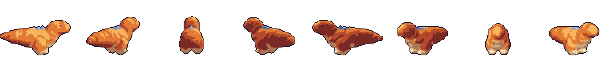

<div align="center">

# 🦖 pixel dino splats

**A dinosaur made of ~7,600 3D gaussian splats, rasterised in software at pixel-art resolution.**

No WebGL. No runtime dependencies. Just soft blobs of light, squeezed into a handful of crunchy colours.


<sub>moss · lagoon · grape · ember — one dino, four colourways</sub>




</div>

---

**🎮 [Live demo →](https://alex-quiterio.github.io/pixel-dino-splats/)** (drag to rotate and tilt, scroll or slide to zoom, arrow keys work too)

## ✨ Features

- **Real gaussian splatting**: every splat is a 3D gaussian with position, scale, colour and opacity, projected to a 2D conic and alpha-blended back to front.
- **True pixel art**: output pixels only ever use palette colours, alpha is hard-thresholded, and the silhouette gets a 1px outline. A test enforces it.
- **Alive**: the tail swishes and the head bobs through a pure `pose(splats, t)` function.
- **Four colourways** picked by seed: moss, lagoon, grape, ember.
- **Interactive web viewer** (GitHub Pages): drag to rotate and tilt, scroll/slider zoom, arrow keys, reset view, toggle spin, reroll colourways, switch between 48 / 64 / 96 / 128 px.
- **Exports**: turntable sprite-sheet PNG, plus a standard 3D Gaussian Splatting `.ply` you can open in any splat viewer for the non-pixel version.
- **Deterministic**: same seed, same dino, every time.

## 🚀 Quick start

```sh
bun install
bun run web:start                  # http://localhost:3000 (PORT=... to change)
bun run cli:export -- --seed 2     # sprite sheet + .ply -> out/
bun run web:build                  # static site -> dist/
```

CLI options: `--seed`, `--size` (px per frame, default 96), `--frames` (default 8), `--scale` (PNG upscale, default 4), `--out`.

Checks: `bun test` · `bun run lint` · `bun run typecheck`

## 🧪 How it works

| Step | What happens |
| --- | --- |
| **1. Grow** | Ellipsoid shells (torso, neck, head, tail chain, legs, plates) are sampled into seeded gaussians, cel-shaded into 4 bands per colour ramp. |
| **2. Project** | Orthographic camera. Each 3D covariance `R·diag(s²)·Rᵀ` becomes a 2D conic, with a small low-pass so sub-pixel splats don't vanish. |
| **3. Splat** | Depth-sort, then alpha-blend gaussians into a tiny float buffer. |
| **4. Pixelate** | Snap each pixel to the nearest palette colour, threshold alpha at 0.5, add the outline. |

## 🗂 Layout

```
src/domain          splats, palettes, dino generator, projection math (pure)
src/application     scene building, pixel renderer, turntable use cases
src/infrastructure  PNG + PLY encoders
apps/cli            sprite-sheet / PLY export
apps/web            viewer (CSS split into styles/)
tests/
```

Built with TypeScript on Bun. ESLint enforces the dependency direction `domain ← application ← infrastructure ← apps` and alias imports (`@domain/...`).

## 🐾 What's next

The generator is really a tiny "creature from ellipsoids" kit, so the plan is a whole pixel bestiary. See **[ANIMALS.md](ANIMALS.md)** for the wishlist.

## License

MIT
