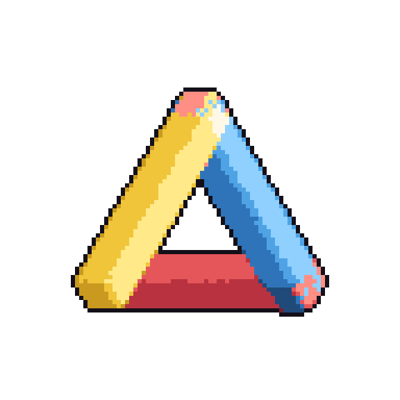
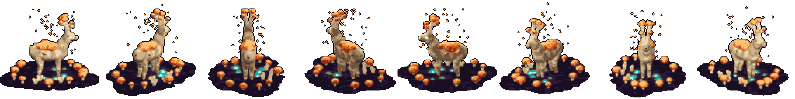
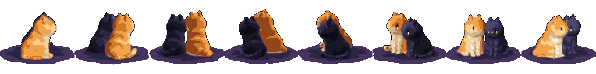
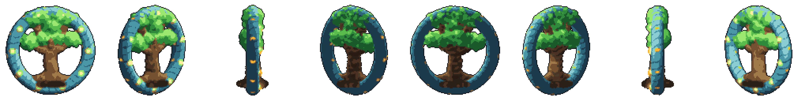
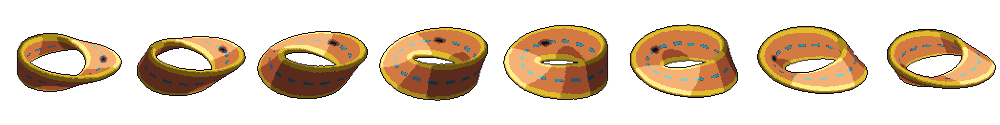
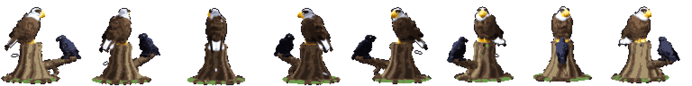
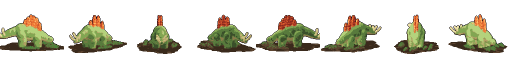
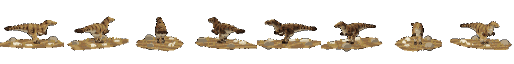
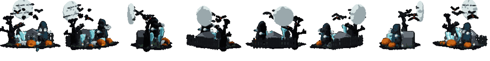

<div align="center">



# 🦖🦑🦌🐈 pixel splat zoo

**Creatures made of thousands of 3D gaussian splats, rasterised in software at pixel-art resolution.**

No WebGL. No runtime dependencies. Just soft blobs of light, squeezed into a handful of crunchy colours.

### T-Rex (scary, jaw roars)


### Squid in the rain


### Mushroom stag


### Ginger & black cats


### Elephant


### Impossible triangle (the logo; only closes from one angle, spin it to break it)


### Tree of life torus (orbs circle the ring)


### Möbius strip (an ant walks its one and only side)


### Eagle & crow (the crow caws, the eagle ignores it, spare feathers drift down)


### Stegosaurus


### Velociraptor


### Haunted graveyard


<sub>more colourways in <a href="assets">assets/</a>: T-Rex (moss, lagoon, grape, ember), squid (coral, violet, kelp), stag (ember, frost, toxic), cats (ginger-black, ginger-grey, butter-black), elephant (savanna, rose, twilight), stegosaurus (fern, dusk, sand), velociraptor (steppe, forest, ash), haunted graveyard (wraith, ectoplasm, bloodmoon), eagle & crow (bald, golden, slate)</sub>

</div>

---

**🎮 [Live demo →](https://alex-quiterio.github.io/pixel-dino-splats/)** (drag to rotate and tilt, scroll or slide to zoom, arrow keys work too)

## 🎯 Purpose

This project is a playground for learning and showing off **3D gaussian splatting from first principles**. Instead of a GPU pipeline or a trained scene, every creature is *hand-sculpted in code* out of a few thousand soft 3D blobs, then rasterised by a small software renderer with no dependencies. It exists to:

- **Demystify splatting**: the whole pipeline (grow, project, blend, quantise) is a few readable files you can step through.
- **Make it charming**: crushing the result to a handful of palette colours turns a research technique into pixel art, which keeps the focus on shape and motion.
- **Be a sandbox for new creatures**: each animal is one file (`build` + `pose` + camera), so adding one is an afternoon of fun, not a framework.
- **Stay portable**: results export as sprite sheets and standard `.ply` splat files you can open in any 3DGS viewer.

It is also a bestiary with opinions. Each creature has something to say:

| Creature | Quote |
| --- | --- |


## ✨ Features

- **Real gaussian splatting**: every splat is a 3D gaussian with position, scale, colour and opacity, projected to a 2D conic and alpha-blended back to front.
- **True pixel art**: output pixels only ever use palette colours, alpha is hard-thresholded, and the silhouette gets a 1px outline. A test enforces it.
- **Alive**: the T-Rex snarls with a glowing eye and roars; the squid waves its arms in a rainy puddle; the stag sheds drifting spores past pulsing glow-orbs; the cats swish their tails, twitch their ears and blink; the elephant sways its trunk and flaps its ears; the stegosaurus grazes and swings its spiked tail; the velociraptor jerks its head between glances and taps its sickle claw; the eagle turns its head away, flares its wings and screeches while the crow caws, bobs and flicks its wings; in the haunted graveyard a hooded wraith looms and reaches, spirits wail up out of their graves, bony hands claw at the dirt, skulls circle, the gibbet cage creaks and the fog rolls. All motion is a pure `pose(splats, t)` function.
- **Detailed**: tiger stripes, scale speckle, brow ridges, teeth, claws and slit-pupil eyes.
- **Colourways** picked by seed, per creature (see above).
- **Interactive web viewer** (GitHub Pages): pick a creature from a grouped menu (it folds away once you choose, leaving quick-switch buttons for the rest of that group), drag to rotate and tilt, scroll/slider zoom, arrow keys, reset view, toggle spin, reroll colourways, switch between 48 and 512 px (48 / 64 / 96 / 128 / 192 / 256 / 384 / 512, with a live ms-per-frame readout).
- **Exports**: turntable sprite-sheet PNG, plus a standard 3D Gaussian Splatting `.ply` you can open in any splat viewer for the non-pixel version.
- **Deterministic**: same seed, same dino, every time.

## 🚀 Quick start

```sh
bun install
bun run web:start                  # http://localhost:3000 (PORT=... to change)
bun run cli:export -- --creature squid --seed 1   # sprite sheet + .ply -> out/
bun run web:build                  # static site -> dist/
```

CLI options: `--creature` (`trex` | `squid` | `stag` | `cats` | `elephant` | `stegosaurus` | `dragon` | `velociraptor` | `halloween` | `penrose` | `torus` | `mobius` | `eagle`), `--seed`, `--size` (px per frame, default 96), `--frames` (default 8), `--scale` (PNG upscale, default 4), `--out`.

Checks: `bun test` · `bun run lint` · `bun run typecheck`

## 🧪 How it works

| Step | What happens |
| --- | --- |
| **1. Grow** | Ellipsoid shells (and chains of small spheres for arms and tentacles) are sampled into seeded gaussians, cel-shaded into 4 bands per colour ramp. |
| **2. Project** | Orthographic camera. Each 3D covariance `R·diag(s²)·Rᵀ` becomes a 2D conic, with a small low-pass so sub-pixel splats don't vanish. |
| **3. Splat** | Depth-sort, then alpha-blend gaussians into a tiny float buffer. |
| **4. Pixelate** | Snap each pixel to the nearest palette colour, threshold alpha at 0.5, add the outline. |

## 🗂 Layout

```
src/domain          splats, palettes, creatures (trex, squid, stag, cats, elephant, stegosaurus, dragon, velociraptor, halloween, penrose, torus, mobius, eagle) + sculpting helper, projection math (pure)
src/application     scene building, pixel renderer, turntable use cases
src/infrastructure  PNG + PLY encoders
apps/cli            sprite-sheet / PLY export
apps/web            viewer (CSS split into styles/)
tests/
```

Built with TypeScript on Bun. ESLint enforces the dependency direction `domain ← application ← infrastructure ← apps` and alias imports (`@domain/...`).

## 🐾 What's next

Each animal is a `Creature` (build + pose + camera framing), so adding one is a single file. so the plan is a whole pixel bestiary. See **[ANIMALS.md](ANIMALS.md)** for the wishlist.

## License

MIT
