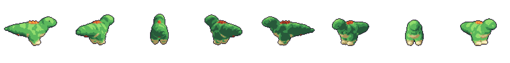
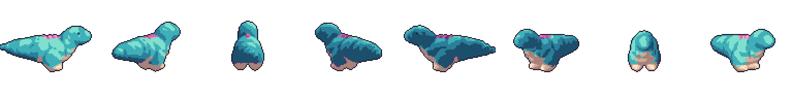
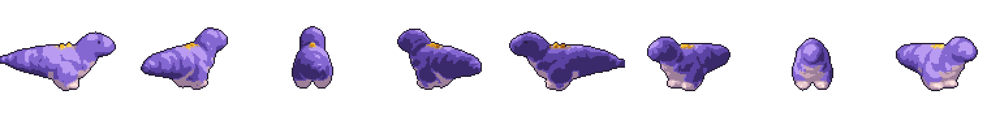

# pixel dino splats 🦖

A dinosaur made of ~7,600 **3D gaussian splats**, rasterised in software at pixel-art resolution (48–128 px), snapped to a hand-picked palette and outlined. No WebGL, no dependencies at runtime.






## How it works

1. **Grow** – the dino is ellipsoid shells (torso, neck, head, tail chain, legs, plates) sampled into seeded gaussians, cel-shaded into 4 bands per colour ramp.
2. **Project** – orthographic camera; each gaussian's 3D covariance `R·diag(s²)·Rᵀ` is projected to a 2D conic.
3. **Splat** – depth-sort, alpha-blend gaussians into a tiny float buffer.
4. **Pixelate** – snap every pixel to the palette, hard-threshold alpha, add a 1px outline.

The tail swishes and the head bobs via a pure `pose(splats, t)` function.

## Run it

```sh
bun install
bun run web:start                 # http://localhost:3000, drag to rotate
bun run cli:export -- --seed 2    # sprite-sheet PNG + 3DGS .ply -> out/
bun run web:build                 # static site -> dist/
bun test && bun run lint && bun run typecheck
```

The exported `.ply` is a standard 3D Gaussian Splatting file, so you can also open it in any splat viewer for the non-pixel version. Seeds 0–3 pick the four colourways (moss, lagoon, grape, ember).

## Layout

```
src/domain          splats, palettes, dino generator, projection math (pure)
src/application     scene building, pixel renderer, turntable use cases
src/infrastructure  PNG + PLY encoders
apps/cli, apps/web  thin entrypoints (web CSS split into styles/)
```

ESLint enforces the dependency direction (`domain ← application ← infrastructure ← apps`) and alias imports.
